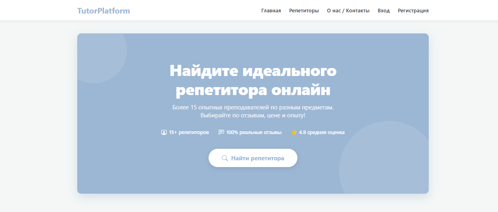
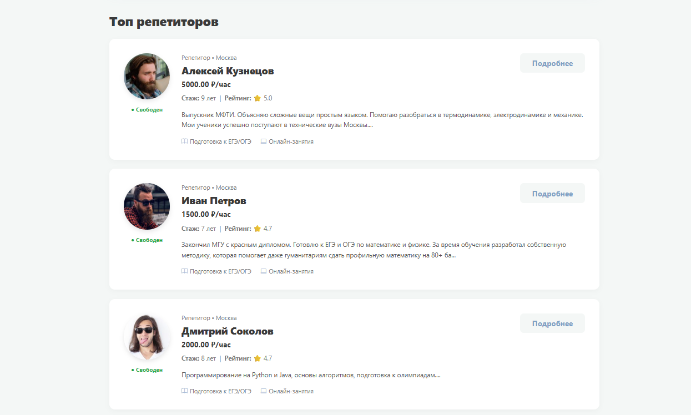
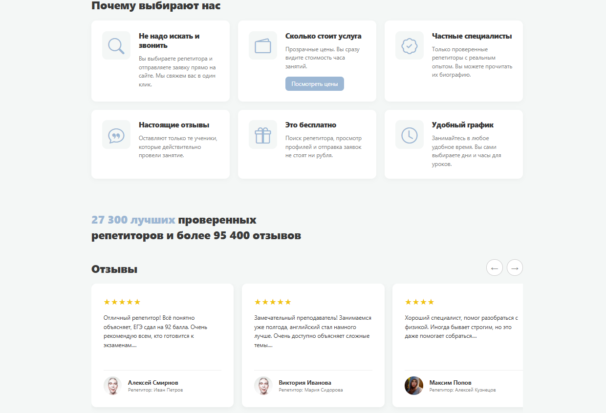
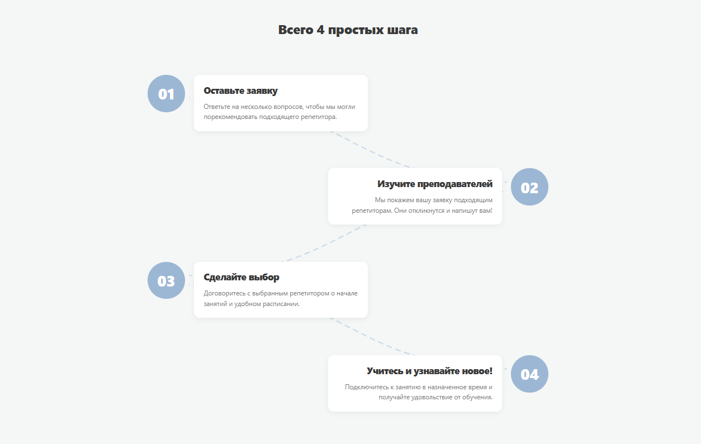
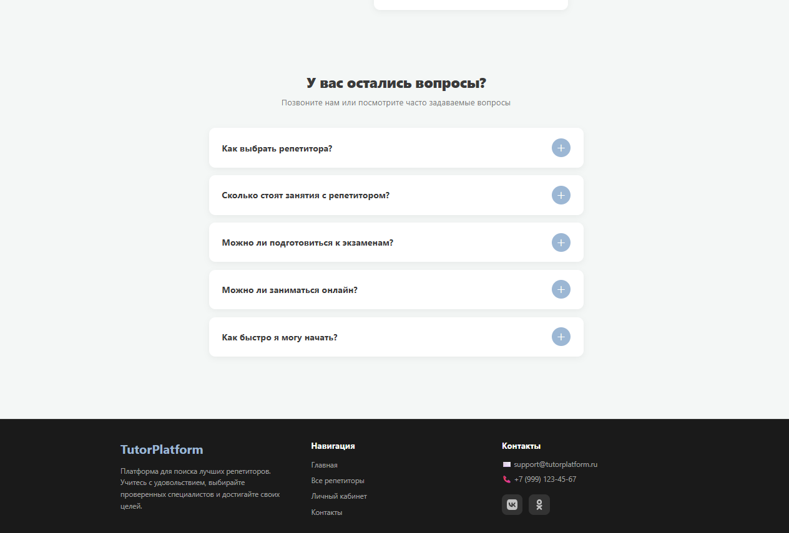
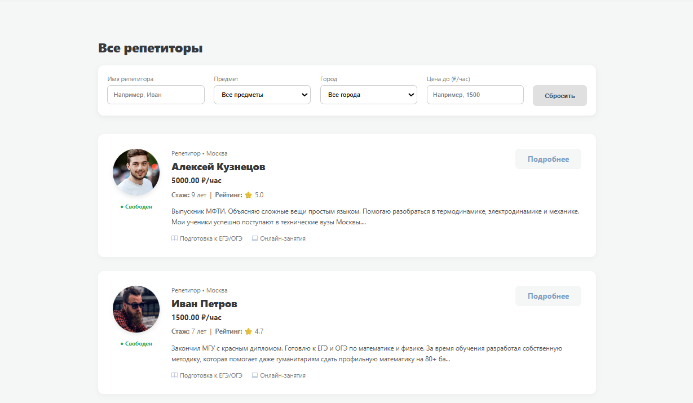
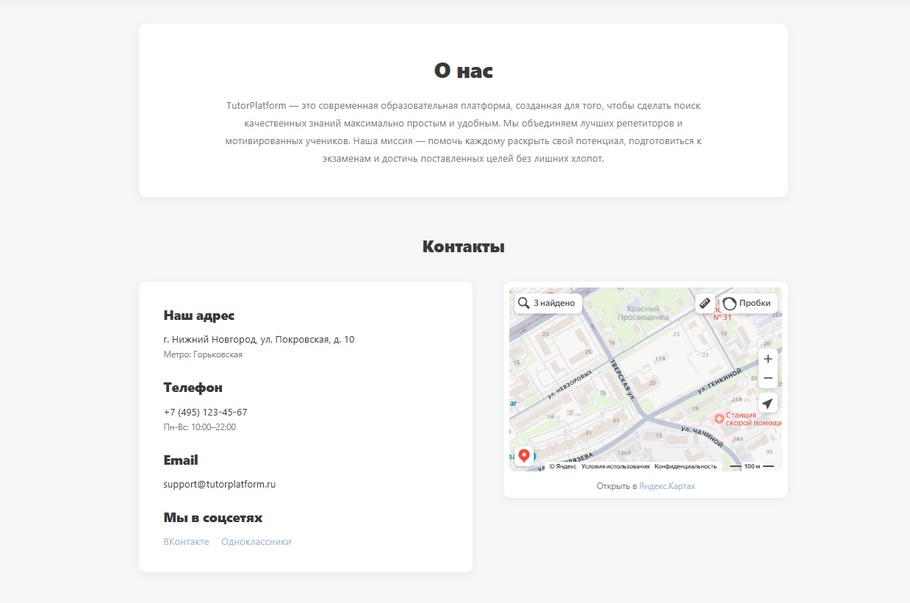
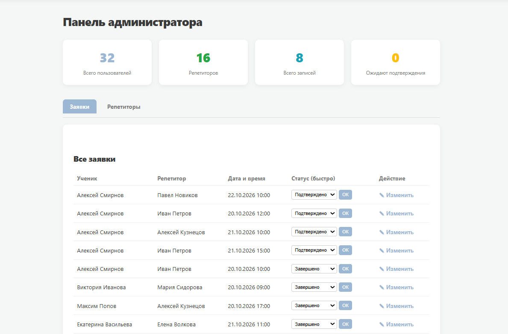
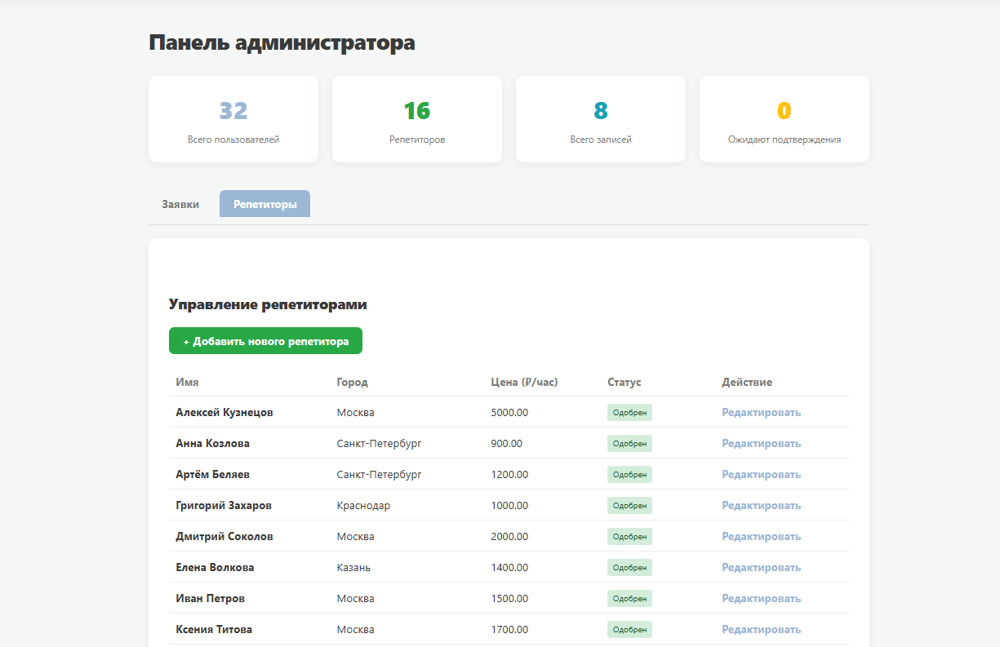

<h1 align="center">TutorPlatform</h1>

  <i>Современная платформа для поиска репетиторов и онлайн-обучения.</i>

 

## Скриншоты

  
    
  
  
    
  
  
    
  
  
    
  
  
     

  <table width="100%">
    <tr>
      <td align="center" width="100%">
        
      </td>
      <td align="center" width="100%">
        
      </td>
    </tr>
    <tr>
      <td align="center" width="100%">
        
      </td>
      <td align="center" width="100%">
        
      </td>
    </tr>
  </table>

 

## О проекте

**TutorPlatform** — это веб-приложение, разработанное для удобного поиска репетиторов. Платформа позволяет пользователям фильтровать специалистов по предметам, опыту и цене, оставлять заявки и просматривать отзывы.

**Ключевой функционал:**
*   **Поиск и фильтрация:** умный подбор репетиторов по нужным критериям.
*   **Личный кабинет:** регистрация и авторизация пользователей.
*    **Заявки:** оформление заявок на занятия через удобную форму.
*    **Отзывы:** система рейтингов и обратной связи.
*    **Админ-панель:** управление анкетами репетиторов и заявками.

## Как развернуть локально

1. **Создай новую базу данных в phpMyAdmin.**
2. **Импортируй в неё файл sql/tutorplatform.sql (он лежит в корне проекта в папке sql).**
3. **В папке config/ открой файл db.php и укажи свои локальные настройки (логин и пароль от БД).**
4. **Открой проект**

## Технологии

*   **Backend:** PHP 8.x, PDO
*   **Frontend:** HTML5, CSS3, JavaScript
*   **База данных:** MySQL
